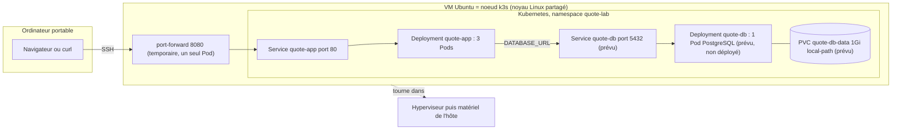

# TP 52 - Notes d'architecture

## Statut : manifestes prêts, vérification sur le cluster en attente
- Dernier résultat validé : le cœur du TP 42, voir [verification.md](../42-kubernetes/verification.md).
- Blocage : ma VM a été réinitialisée et k3s n'y est plus installé. Sur le réseau Ethernet de l'université, le pare-feu Fortinet remplace les certificats HTTPS : `curl https://get.k3s.io` échoue avec `unable to get local issuer certificate` (émetteur `Fortinet, CN=FG100FTK21024358`). Je ne peux donc pas télécharger k3s ni les images Docker.
- Prochaine action : refaire le cluster depuis un réseau sans inspection HTTPS (ou avec le certificat de l'école donné par le prof), puis faire les vérifications ci-dessous.
- Déjà prêt dans le dépôt : `database.yaml`, `db-init-configmap.yaml` et `init.sql` (ce dossier), l'appli avec `DATABASE_URL` (`labs/42-kubernetes/deployment.yaml`, image `quote-app:v2`) et le `SELECT` / `INSERT` activés dans `app.js`. Le Secret `quote-db-secret` sera créé dans le cluster, jamais dans Git.

## Schéma de mon installation

Le port-forward cible un seul Pod : il ne montre pas la répartition du Service. Le chemin dans le cluster (Pod client vers `http://quote-app`) a été vérifié au TP 42. PostgreSQL est prévu : il n'est pas encore déployé.

## Vérifications à faire (pas encore faites)
- [ ] PVC `quote-db-data` en Bound et Pod PostgreSQL prêt
- [ ] Citation unique insérée par l'appli puis relue
- [ ] Même citation retrouvée après remplacement du Pod PostgreSQL (même PVC)
- Noms des Pods avant / après : à compléter. Marqueur de la citation : à compléter.

## Notes
1. **Noyau partagé** : les conteneurs de l'appli et de PostgreSQL tournent sur la même VM Ubuntu et partagent son noyau Linux. L'hyperviseur crée la VM, Kubernetes gère seulement ce qui tourne dedans.
2. **Frontière de persistance** : les données de PostgreSQL seront sur le PVC (local-path) et non dans le conteneur, donc elles doivent survivre au remplacement du Pod (à vérifier). Ce volume est un dossier de la VM : si la VM ou son disque disparaît, les données aussi. Les 3 réplicas de l'appli n'y changent rien.
3. **Limite et prochaine action** : une seule base, un seul nœud, pas de sauvegarde, et la vérification sur le cluster reste à faire. Prochaine action : refaire le cluster sur un réseau sans inspection HTTPS et dérouler les vérifications.
