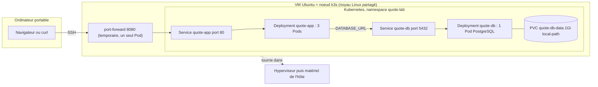

# TP 52 - Notes d'architecture

## Statut : vérifications du TP 52 faites sur le cluster
- Cœur du TP 42 validé : voir [verification.md](../42-kubernetes/verification.md) (health, 3 réplicas, remplacement de Pod, échec et récupération de la readiness).
- La VM avait été réinitialisée, le cluster a été refait : namespace `quote-lab`, image `quote-app:v2` construite avec Docker puis importée dans k3s (`sudo k3s ctr images import`).
- PostgreSQL est déployé avec `db-init-configmap.yaml` et `database.yaml`. Le Secret `quote-db-secret` est créé dans le cluster avec `kubectl create secret` et n'est pas dans Git ; les manifestes y font seulement référence (`secretRef`, `secretKeyRef`).
- Prochaine action : voir la note 3.

## Schéma de mon installation

Le port-forward cible un seul Pod : il ne montre pas la répartition du Service. Le chemin dans le cluster (Pod client vers `http://quote-app`) a été vérifié au TP 42. PostgreSQL est déployé et vérifié ci-dessous.

## Vérifications de la base (faites)
- [x] PVC `quote-db-data` en **Bound** (1Gi, `local-path`) et Pod PostgreSQL **1/1 Ready**.
- [x] Citation unique insérée par l'appli (`POST /quotes` -> 302) puis relue dans la page : `res509-1795642127`.
- [x] Même citation retrouvée après `kubectl rollout restart deployment/quote-db` (même PVC).

| | Pod PostgreSQL | PVC | Citation `res509-1795642127` |
|---|---|---|---|
| Avant | `quote-db-796c9c9d49-l6mff` | `quote-db-data` Bound | trouvée |
| Après | `quote-db-6b49d4cb84-tm6cm` | `quote-db-data` Bound (même volume) | trouvée |

Extrait de commande : `kubectl get pvc quote-db-data` -> `Bound pvc-600eb9c4-688a-47f7-8256-968aa5d460f5 1Gi RWO local-path`.

Ce test prouve que les données survivent au remplacement du Pod, parce qu'elles sont sur le PVC et non dans le conteneur. Il ne prouve rien contre la perte de la VM ou de son disque.

## Notes
1. **Noyau partagé** : les conteneurs de l'appli et de PostgreSQL tournent sur la même VM Ubuntu et partagent son noyau Linux. L'hyperviseur crée la VM, Kubernetes gère seulement ce qui tourne dedans.
2. **Frontière de persistance** : les données de PostgreSQL sont sur le PVC (`local-path`), qui est un dossier de la VM, donc elles survivent au remplacement du Pod (vérifié). Si la VM ou son disque disparaît, les données aussi : les 3 réplicas de l'appli n'y changent rien.
3. **Limite et prochaine action** : une seule base, un seul nœud, pas de sauvegarde (aucun `pg_dump`). Prochaine action : tester une sauvegarde et une restauration de la base, puis voir une option multi-nœuds au TP 62.
