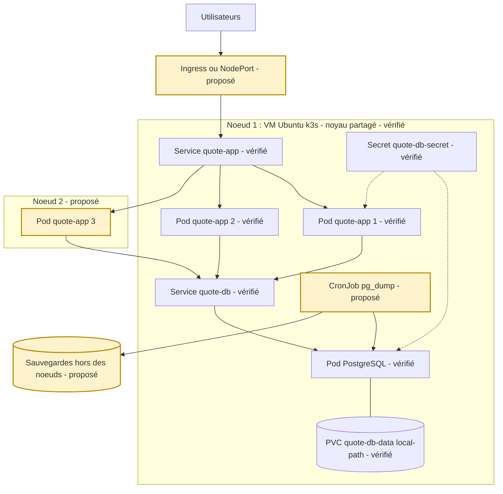

# Lab 62 - Final architecture

Légende : **[vérifié]** = fait et testé sur ma VM (Lab 42 ou 52). **[proposé]** = changement de conception, non testé.

Résultats de référence : [Lab 42](../42-kubernetes/verification.md) et [Lab 52](../52-architecture/architecture-notes.md).

## Current System Problems

| # | Problème | Conséquence | Correction proposée |
|---|---|---|---|
| 1 | PostgreSQL tourne dans le même conteneur que l'appli, avec ses données dans la couche inscriptible du conteneur | Si le Pod est remplacé, **toute la base disparaît** | Base dans son propre Deployment + Service, données sur un PVC **[vérifié Lab 52]** : la citation a survécu au remplacement du Pod |
| 2 | Un seul Pod et stratégie Recreate | Chaque panne ou mise à jour = **indisponibilité** (l'ancien Pod est arrêté avant que le nouveau soit prêt) | 3 réplicas **[vérifié Lab 42]** + `RollingUpdate` avec `maxUnavailable: 0` **[proposé]** |
| 3 | Aucune sonde (readiness, liveness) | Du trafic part vers un Pod cassé, et un processus bloqué n'est jamais redémarré | `readinessProbe` et `livenessProbe` sur `/health` **[vérifié Lab 42]**. Sans lien avec la base, pour ne pas redémarrer l'appli quand la base est lente |
| 4 | Aucune limite de ressources | Un Pod gourmand peut affamer les autres et le nœud | `requests` et `limits` CPU/mémoire sur chaque conteneur **[proposé]** |
| 5 | Identifiants en clair dans le manifeste, commité dans Git | Le mot de passe fuit avec le dépôt | Secret créé avec `kubectl create secret`, manifestes avec `secretKeyRef` / `secretRef` seulement **[vérifié Lab 52]** |
| 6 | Un seul nœud et un seul disque, aucune sauvegarde testée | Si la VM ou le disque disparaît, **les données sont perdues** | Sauvegarde `pg_dump` régulière **hors du nœud** + restauration testée ; plusieurs nœuds **[proposé]** |

**Observation réelle (11/2026) :** sur ma VM sous forte charge (load average 10 à 15), mes sondes à délais courts ont expiré et Kubernetes a redémarré en boucle les 3 Pods (`CrashLoopBackOff`). Les sondes sont utiles, mais leurs délais (`initialDelaySeconds`, `timeoutSeconds`) doivent tenir compte d'une machine lente.

## Production Architecture

Les éléments en **jaune** sont les changements proposés. Le reste est ce que j'ai déployé et vérifié au Lab 52.

**Composants :**
- **Deployment de l'appli**, 3 réplicas, `RollingUpdate`, sondes `/health`, `requests`/`limits` **[proposé pour les limites et la stratégie, le reste vérifié]**.
- **Service `quote-app`** qui répartit les requêtes entre les Pods prêts **[vérifié]**.
- **PostgreSQL** dans son propre Pod avec un **PVC** (`local-path`, 1Gi) et un Service `quote-db` **[vérifié]**.
- **Secret** `quote-db-secret` créé dans le cluster, jamais commité ; le manifeste y fait référence **[vérifié]**. En production, le fournir via un gestionnaire de secrets **[proposé]**.
- **Sauvegarde** : un CronJob lance `pg_dump` et envoie le fichier **hors du nœud** **[proposé, non testé]**.

**Si un Pod échoue :**
- *Pod de l'appli* : le ReplicaSet en recrée un, et les autres répondent pendant ce temps **[vérifié Lab 42]**.
- *Pod PostgreSQL* : Kubernetes en recrée un qui se rattache au même PVC, donc les données restent **[vérifié Lab 52]**. Il y a une courte indisponibilité de la base (un seul Pod, stratégie `Recreate`).

**Si la VM ou le disque est perdu :**
- Les 3 réplicas et le PVC `local-path` sont **sur le même nœud**, donc tout disparaît avec lui.
- Seule une **sauvegarde hors du nœud**, avec une restauration déjà testée, permet de récupérer les données. Un PVC n'est pas une sauvegarde.
- Un second nœud permet de garder l'appli disponible si un nœud tombe, mais ne sauve pas la base tant qu'elle reste sur un seul disque.

**Disponibilité ≠ récupération des données :** les réplicas protègent contre la panne d'un Pod (disponibilité). Seule la sauvegarde protège contre la perte du disque (récupération).

## Operational Strategy

- **Montée en charge :** augmenter `replicas` (`kubectl scale`), ou un HorizontalPodAutoscaler sur le CPU **[proposé, nécessite des `requests` et un serveur de métriques]**. La base ne se multiplie pas avec les réplicas : c'est elle qui limitera en premier.
- **Mises à jour sûres :** `RollingUpdate` (un nouveau Pod à la fois, l'ancien reste tant que le nouveau n'est pas prêt). Je vérifie avec `kubectl rollout status` et `get pods`. Si la nouvelle version est mauvaise : `kubectl rollout undo deployment/quote-app`. Le Lab 42 m'a montré le cas où le nouveau Pod reste `0/1` sans casser le service **[vérifié]**.
- **Pourquoi un rollback ne restaure pas la base :** `rollout undo` ne remet que le modèle de Pod (image, config). Les données et le schéma sont dans le PVC et ne reviennent pas en arrière. Pour une migration de schéma : sauvegarde avant, et migrations compatibles avec l'ancienne et la nouvelle version **[proposé]**.
- **Détection des pannes :** la readiness retire le Pod du trafic, la liveness le redémarre **[vérifié Lab 42]**. Je surveille `kubectl get pods` (colonne READY, RESTARTS) et `kubectl get events` : j'y ai lu `Readiness probe failed` et `Node is not ready` **[vérifié]**.
- **Contrôleurs qui récupèrent :** le *Deployment/ReplicaSet* recrée les Pods manquants ; le *kubelet* redémarre un conteneur dont la liveness échoue ; le *node controller* marque un nœud `NotReady`. Ils ne remplacent pas une **sauvegarde/restauration** ni la reconstruction d'un nœud perdu.

## Weakest Point

**La base PostgreSQL unique, sur le disque d'un seul nœud.** Elle tombera la première : si ce disque est perdu, je ne récupère que la dernière sauvegarde, et pendant le remplacement du Pod la base est indisponible.

**Compromis :** passer à une base répliquée ou managée supprime ce point faible, mais ajoute de la complexité, du coût et des opérations (réplication, bascule, tests). Pour une petite équipe, une sauvegarde régulière **testée** hors du nœud est le meilleur rapport simplicité/sécurité avant d'ajouter la réplication.

**Limites de ce que j'ai vérifié :** la sauvegarde `pg_dump`, la restauration, le second nœud, les limites de ressources et l'autoscaling sont **proposés mais non testés** dans mon lab.
